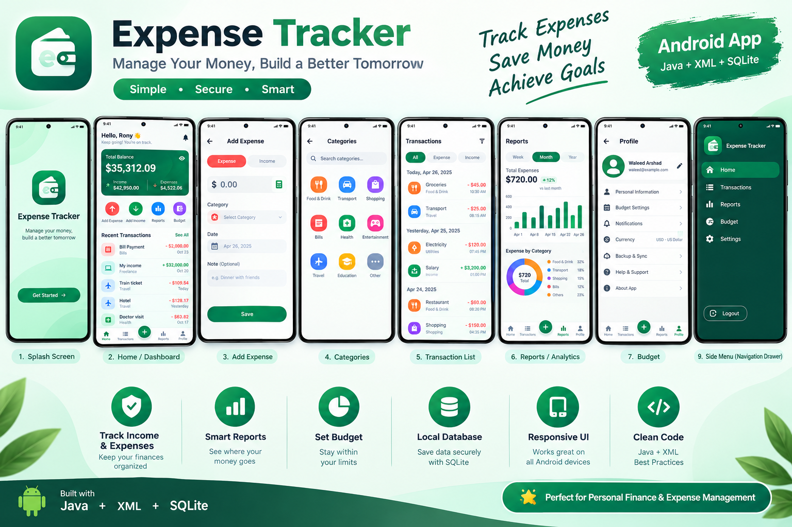
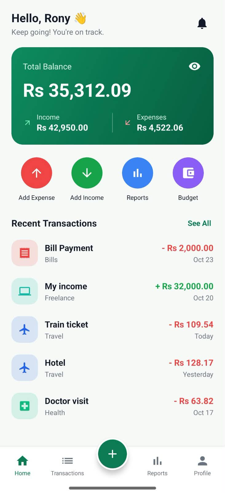
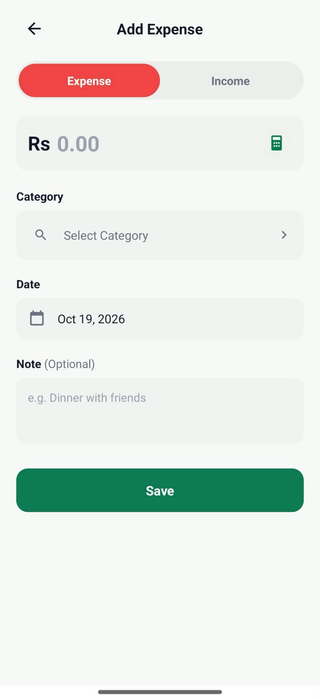
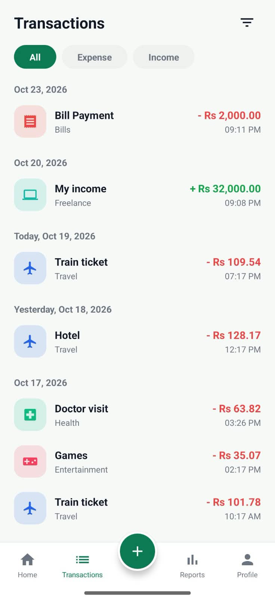
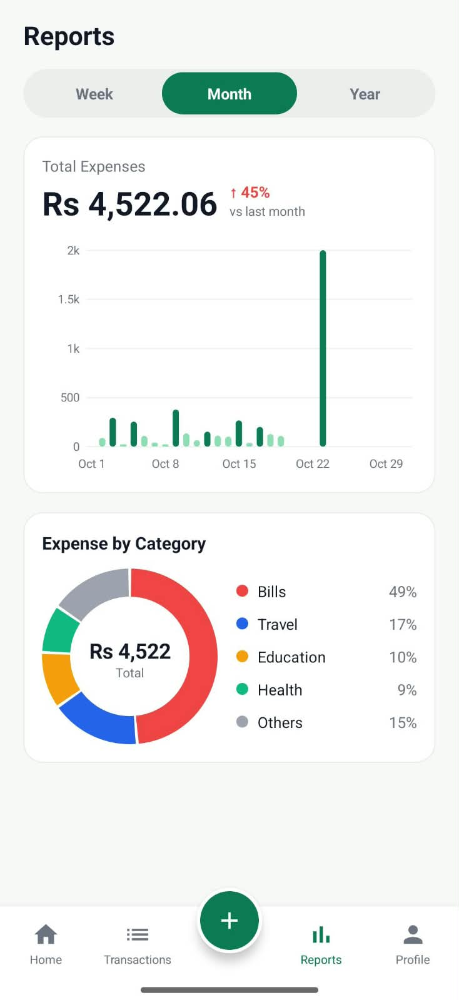
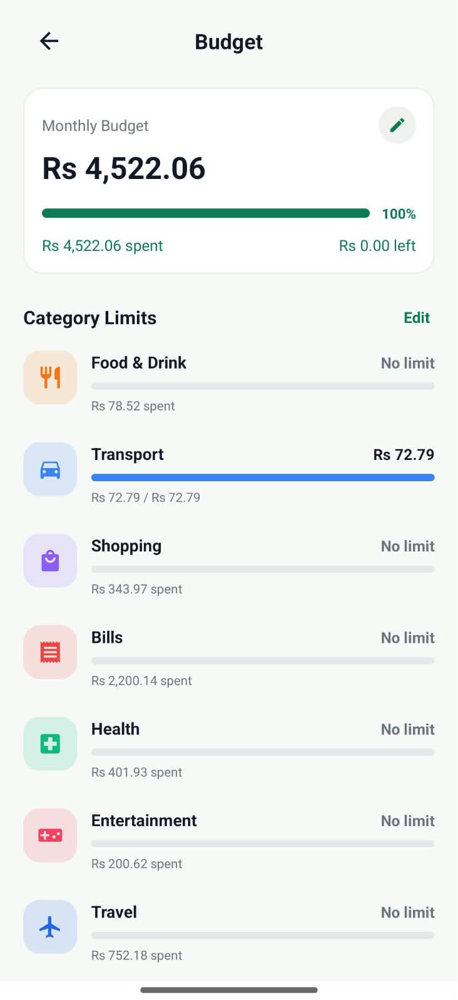
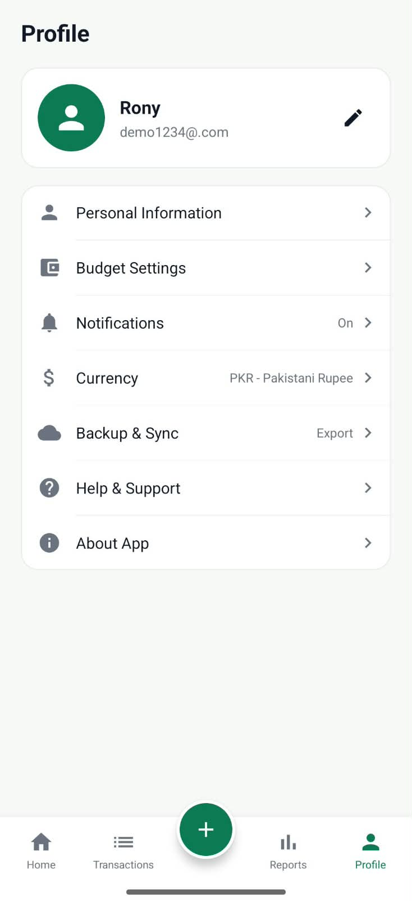

# ExpenseTracker

A clean, modern personal finance app for Android, built with Java, XML and SQLite in Android Studio.

Track your income and expenses, organize spending by category, set budgets and see where your money goes. All data is stored locally on your device.

## Screenshots

| Home | Add Expense | Transactions |
|------|-------------|--------------|
|  |  |  |

| Reports | Budget | Profile |
|---------|--------|---------|
|  |  |  |

## Features

- Home: total balance, income and expense summary, quick actions (Add Expense, Add Income, Reports, Budget) and a recent transactions list
- Add Expense: Expense / Income switch with amount, category, date and an optional note
- Transactions: list grouped by date (Today, Yesterday, older dates) with All / Expense / Income filters
- Reports: weekly, monthly and yearly analytics with a bar chart, month-over-month change and expense breakdown by category in a donut chart
- Budget: monthly budget with progress bar and per-category spending limits
- Profile: user card and settings list (personal info, budget settings, notifications, currency, backup and export, help, about)
- Bottom navigation with a floating add button, built with fragments
- Local database: data saved securely with SQLite
- Light theme, rounded cards, consistent spacing

## Tech stack

- Java
- XML layouts and vector drawables
- SQLite for local storage
- Android Fragments and a bottom navigation bar
- Gradle

## How to run

1. Clone the repository
2. Open the folder in Android Studio
3. Wait for Gradle sync to finish
4. Run the app configuration on an emulator or a real device

## Author

Waleed Arshad, Android developer
GitHub: [itxwaleed007-dotcom](https://github.com/itxwaleed007-dotcom)
